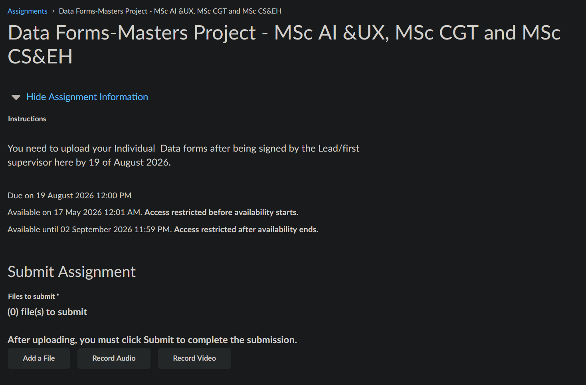

# Report for period 2026-08-13 to 2026-08-19

**Goals from last meeting:**

- Finish writing the Methodology, including the tracing environment, the file validation parts, and the four environment design process.
- Start writing the Results and Discussion part using the tables and plots from the notebooks.

**Activity this period:**

- Started the Methodology section and almost about to finish the methodology section.

**Goals before next meeting:**

- Finish the Methodology section by Today (08/13)
- Finished the entire report before 16th and send for

**Items to discuss:**

- About the current progress of the report.
- **Data Forms-Masters Project - MSc AI &UX, MSc CGT and MSc CS&EH - What is this?**

---

Items discussed with supervisor: (After the meeting)

- Search for the Data Form template on MLS
- Agree to complete the draft on the 16th and get feedback.